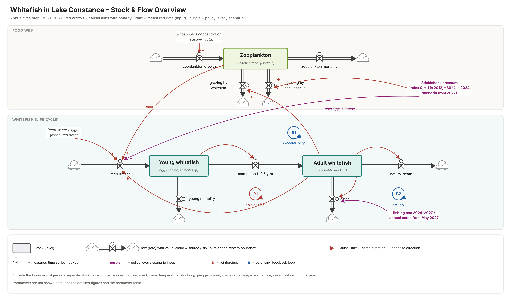

<a id="readme-top"></a>

<div align="center">

# Modelling of Complex Systems

This is the semester project for the course of *CO1: Modelling of Complex Systems*, for the Autumn 2026 semester of the ZHAW Master in Life Sciences.


</div>

## Table of Contents

- [Modelling of Complex Systems](#modelling-of-complex-systems)
	- [Table of Contents](#table-of-contents)
	- [About](#about)
	- [Project Structure](#project-structure)
	- [Getting Started](#getting-started)
		- [Prerequisites](#prerequisites)
	- [Usage](#usage)
	- [Authors](#authors)
	- [License](#license)

## About

This repository contains the semester project for the ZHAW course of CO1: Modelling of Complex Systems.

The aim is to develop a simplified system dynamics model of Lake Constance that links phosphorus, plankton, deep-water oxygen and the whitefish population for the period from 1950 to 2050, and to calibrate it using historical measurement data.




[Back to top](#readme-top)

## Goals

The model will be used to address the following research questions:
- H1: The model can reproduce the historical data.​
- H2: The model can show the contribution effects of the 2024 fishing ban and the decline of the stickleback population to the recovery of the whitefish stock.​
- H3: The model can simulate the maximum annual catch that can be permitted from 2027 onwards, to ensure that the stock remains above a reference level until 2050​ (on low and renewed stickleback pressure)​

[Back to top](#readme-top)

## Project Structure


```text
modelling-of-complex-systems/
├── README.md          # Project overview and instructions
├── LICENSE            # Project license
├── deliverable/       # Files to be submitted for evaluation
├── documentation/     # Main project documentation
├── images/            # Images related to the project
└── model/             # Model files and related code
```

[Back to top](#readme-top)

## Getting Started

```sh
git clone https://github.com/the-nerd-sloth/co1-semester-project.git
cd co1-semester-project/model
# Open the Vensim model from the application
```

### Prerequisites

- Git
- Vensim installation


[Back to top](#readme-top)

## Usage

- Follow the Installation instructions.
- Follow the course's instructions on Vensim.

[Back to top](#readme-top)

## Authors

- **Anika Heim**
	- GitHub: [@anika-dot](https://github.com/anika-dot)
- **Spyridon Margomenos**
	- Github: [@the-nerd-sloth](https://github.com/the-nerd-sloth)
- **Rebecca**
	- Github: [@rebsie](https://github.com/rebsie)

[Back to top](#readme-top)

## License
Distributed under The Unlicense license.
For more information see `LICENSE`.

[Back to top](#readme-top)
